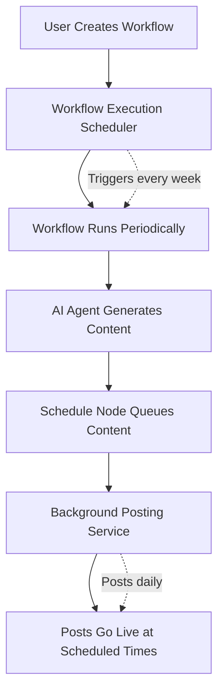

# 🕐 Scheduling Architecture Design Document

## 📋 Overview

This document outlines the dual-layer scheduling architecture for automated content generation and posting in the No Code Sutra platform, specifically designed for recurring social media content workflows.

## 🎯 Core Problem Statement

**Challenge**: Users want to set up automated social media posting (e.g., daily carousel posts) that:
- Generates fresh content periodically (weekly)
- Posts content at optimal times (daily)
- Runs indefinitely without manual intervention
- Maintains content quality and variety

**Solution**: Two-layer scheduling architecture separating content generation from content distribution.

---

## 🏗️ Architecture Overview

### **Two Distinct Scheduling Layers**



### **Layer 1: Workflow Execution Scheduling (System Level)**
- **Purpose**: Controls WHEN the workflow itself executes
- **Responsibility**: Content generation timing
- **Managed By**: System-level workflow scheduler
- **Frequency**: Weekly/Monthly (content generation cycles)

### **Layer 2: Content Scheduling (Node Level)**
- **Purpose**: Controls WHEN generated content gets posted
- **Responsibility**: Content distribution timing  
- **Managed By**: Schedule node within workflows
- **Frequency**: Daily/Hourly (individual post timing)

---

## 📋 Component Specifications

### **1. Workflow Execution Scheduler**

#### **Purpose**
- Manages recurring execution of entire workflows
- Ensures continuous content generation
- Handles workflow-level scheduling logic

#### **Key Features**
```yaml
Recurring Execution:
  - Cron-based scheduling
  - Configurable intervals (daily, weekly, monthly)
  - Timezone support
  - Execution history tracking

Smart Triggering:
  - Content-level triggers (when queue is low)
  - Performance-based adjustments
  - Failure recovery and retry logic
  - Buffer management (generate before running out)

Configuration:
  - User-defined schedules
  - Advance generation timing
  - Failure handling policies
  - Resource allocation limits
```

#### **API Interface**
```python
class WorkflowScheduler:
    def schedule_recurring_workflow(
        self, 
        workflow_id: str,
        schedule: RecurringSchedule,
        config: SchedulerConfig
    ) -> ScheduleResult
    
    def pause_scheduled_workflow(self, schedule_id: str) -> bool
    def resume_scheduled_workflow(self, schedule_id: str) -> bool
    def get_execution_history(self, workflow_id: str) -> List[ExecutionRecord]
```

#### **Configuration Schema**
```json
{
  "workflow_execution_schedule": {
    "frequency": "weekly",
    "cron_expression": "0 20 * * 0",
    "timezone": "UTC",
    "advance_generation_days": 2,
    "max_retries": 3,
    "failure_policy": "exponential_backoff",
    "content_buffer_threshold": 3
  }
}
```

### **2. Schedule Node**

#### **Purpose**
- Queues generated content for future posting
- Manages individual post timing
- Handles content distribution logic

#### **Key Features**
```yaml
Content Queueing:
  - Batch content scheduling
  - Smart time distribution
  - Template rotation enforcement
  - Duplicate prevention

Posting Strategies:
  - Fixed time slots
  - Optimal time suggestions
  - Audience-based timing
  - Platform-specific scheduling

Queue Management:
  - Priority-based ordering
  - Content expiration handling
  - Emergency content insertion
  - Queue health monitoring
```

#### **Node Interface**
```python
class ScheduleNode:
    def execute(self, state: Dict[str, Any]) -> Dict[str, Any]:
        """
        Processes generated content and queues for posting
        
        Input State:
        - generated_content: List of content pieces
        - schedule_config: Posting schedule configuration
        - template_rotation: Template variety rules
        
        Output State:
        - scheduled_posts: List of queued posts with timestamps
        - queue_status: Current queue health metrics
        - next_execution_time: When workflow should run again
        """
```

#### **Configuration Schema**
```json
{
  "type": "schedule",
  "config": {
    "posting_schedule": {
      "frequency": "daily",
      "times": ["09:00", "15:00"],
      "timezone": "America/New_York",
      "skip_weekends": false
    },
    "content_distribution": {
      "spread_evenly": true,
      "respect_template_rotation": true,
      "minimum_gap_hours": 6
    },
    "queue_management": {
      "max_queue_size": 50,
      "content_expiry_days": 30,
      "priority_rules": ["user_priority", "engagement_prediction"]
    }
  }
}
```

### **3. Background Posting Service**

#### **Purpose**
- Monitors scheduled content queue
- Executes posting at designated times
- Handles posting failures and retries

#### **Key Features**
```yaml
Queue Monitoring:
  - Continuous queue polling
  - Time-based trigger execution
  - Health check and alerting
  - Performance metrics tracking

Posting Execution:
  - Multi-platform support
  - Atomic posting operations
  - Failure recovery mechanisms
  - Rate limit compliance

Analytics Integration:
  - Post performance tracking
  - Engagement metrics collection
  - Success/failure reporting
  - Optimization feedback loop
```

---

## 🔄 Workflow Examples

### **Example 1: Daily Carousel Posts**

#### **User Configuration**
```yaml
Goal: "Post 1 carousel about AI trends daily, generate fresh content weekly"

Workflow Execution Schedule:
  frequency: "weekly"
  day: "sunday"
  time: "20:00"
  timezone: "UTC"

Schedule Node Config:
  posting_frequency: "daily"
  posting_time: "10:00"
  content_count: 7
  template_rotation: true
```

#### **Execution Flow**
```
Week 1:
  Sunday 8 PM: Workflow executes
    ├── AI Agent: Generates 7 AI trend carousels
    ├── Template Engine: Applies varied templates
    ├── Schedule Node: Queues posts for Mon-Sun at 10 AM
    └── Returns: 7 posts scheduled for upcoming week

  Monday-Sunday 10 AM: Background service posts 1 carousel daily

Week 2:
  Sunday 8 PM: Workflow executes again
    ├── Generates 7 NEW AI trend carousels
    ├── Ensures template variety from previous week
    └── Queues for the following week

  Continues indefinitely...
```

### **Example 2: Multi-Platform Business Updates**

#### **User Configuration**
```yaml
Goal: "Post business updates 3x/week on Instagram and LinkedIn, fresh content bi-weekly"

Workflow Execution Schedule:
  frequency: "bi-weekly"
  day: "monday"
  time: "09:00"

Schedule Node Config:
  posting_frequency: "3x_weekly"
  posting_days: ["monday", "wednesday", "friday"]
  posting_time: "14:00"
  platforms: ["instagram", "linkedin"]
```

#### **Execution Flow**
```
Bi-weekly Schedule:
  Week 1 Monday 9 AM: Generate 6 business posts (3 per week × 2 weeks)
  Week 1: Posts on Mon/Wed/Fri at 2 PM
  Week 2: Posts on Mon/Wed/Fri at 2 PM
  Week 3 Monday 9 AM: Generate next 6 business posts
  
  Continues indefinitely...
```

---

## 🏗️ Technical Implementation

### **Database Schema**

#### **Workflow Schedules Table**
```sql
CREATE TABLE workflow_schedules (
    id UUID PRIMARY KEY,
    workflow_id UUID REFERENCES workflows(id),
    user_id UUID REFERENCES users(id),
    schedule_type VARCHAR(50), -- 'recurring', 'one_time'
    cron_expression VARCHAR(100),
    timezone VARCHAR(50),
    is_active BOOLEAN DEFAULT true,
    next_execution_time TIMESTAMP,
    last_execution_time TIMESTAMP,
    execution_count INTEGER DEFAULT 0,
    config JSONB,
    created_at TIMESTAMP DEFAULT NOW(),
    updated_at TIMESTAMP DEFAULT NOW()
);
```

#### **Content Queue Table**
```sql
CREATE TABLE content_queue (
    id UUID PRIMARY KEY,
    workflow_execution_id UUID,
    user_id UUID REFERENCES users(id),
    content_data JSONB,
    scheduled_post_time TIMESTAMP,
    platform VARCHAR(50),
    status VARCHAR(50), -- 'queued', 'posted', 'failed', 'cancelled'
    priority INTEGER DEFAULT 0,
    retry_count INTEGER DEFAULT 0,
    posted_at TIMESTAMP,
    created_at TIMESTAMP DEFAULT NOW(),
    
    INDEX idx_scheduled_time (scheduled_post_time),
    INDEX idx_status_platform (status, platform),
    INDEX idx_user_schedule (user_id, scheduled_post_time)
);
```

#### **Execution History Table**
```sql
CREATE TABLE workflow_executions (
    id UUID PRIMARY KEY,
    workflow_id UUID REFERENCES workflows(id),
    schedule_id UUID REFERENCES workflow_schedules(id),
    user_id UUID REFERENCES users(id),
    status VARCHAR(50), -- 'running', 'completed', 'failed'
    started_at TIMESTAMP,
    completed_at TIMESTAMP,
    content_generated_count INTEGER,
    posts_scheduled_count INTEGER,
    execution_logs JSONB,
    error_details TEXT
);
```

### **Service Architecture**

#### **Workflow Scheduler Service**
```python
class WorkflowSchedulerService:
    def __init__(self):
        self.scheduler = AsyncScheduler()
        self.workflow_executor = WorkflowExecutor()
        self.db = DatabaseManager()
    
    async def start_recurring_schedule(self, workflow_id: str, config: ScheduleConfig):
        """Set up recurring workflow execution"""
        
    async def execute_scheduled_workflow(self, schedule_id: str):
        """Execute a scheduled workflow"""
        
    async def monitor_content_levels(self):
        """Check if content generation is needed"""
        
    async def handle_execution_failure(self, execution_id: str, error: Exception):
        """Handle workflow execution failures"""
```

#### **Content Queue Manager**
```python
class ContentQueueManager:
    def __init__(self):
        self.db = DatabaseManager()
        self.posting_service = PostingService()
    
    async def add_content_batch(self, content_list: List[Content], schedule_config: ScheduleConfig):
        """Add generated content to posting queue"""
        
    async def get_ready_posts(self) -> List[QueuedPost]:
        """Get posts ready for publishing"""
        
    async def mark_post_completed(self, post_id: str, result: PostingResult):
        """Update post status after posting attempt"""
        
    async def cleanup_expired_content(self):
        """Remove expired content from queue"""
```

#### **Background Posting Service**
```python
class BackgroundPostingService:
    def __init__(self):
        self.queue_manager = ContentQueueManager()
        self.platform_clients = PlatformClientManager()
        self.scheduler = AsyncScheduler()
    
    async def start_posting_monitor(self):
        """Start continuous monitoring for ready posts"""
        
    async def process_ready_posts(self):
        """Process all posts ready for publishing"""
        
    async def execute_post(self, queued_post: QueuedPost) -> PostingResult:
        """Execute individual post to platform"""
        
    async def handle_posting_failure(self, post_id: str, error: Exception):
        """Handle individual posting failures"""
```

---

## 🔧 Configuration Examples

### **Simple Daily Posts**
```json
{
  "workflow_execution_schedule": {
    "frequency": "weekly",
    "day": "sunday",
    "time": "18:00",
    "timezone": "America/New_York"
  },
  "schedule_node_config": {
    "posting_schedule": {
      "frequency": "daily",
      "time": "09:00",
      "skip_weekends": false
    },
    "content_distribution": {
      "spread_evenly": true,
      "template_rotation": true
    }
  }
}
```

### **Complex Multi-Platform Schedule**
```json
{
  "workflow_execution_schedule": {
    "frequency": "bi-weekly",
    "day": "monday",
    "time": "08:00",
    "advance_generation_days": 3
  },
  "schedule_node_config": {
    "posting_schedule": {
      "frequency": "custom",
      "schedule": [
        {"day": "monday", "time": "10:00", "platforms": ["instagram", "linkedin"]},
        {"day": "wednesday", "time": "14:00", "platforms": ["instagram"]},
        {"day": "friday", "time": "16:00", "platforms": ["linkedin", "twitter"]}
      ]
    },
    "content_distribution": {
      "platform_optimization": true,
      "audience_timing": true,
      "engagement_based": true
    }
  }
}
```

---

## 🚀 Implementation Phases

### **Phase 1: Basic Scheduling (MVP)**
- ✅ Workflow execution scheduler with cron support
- ✅ Simple schedule node for fixed-time posting
- ✅ Basic content queue with database storage
- ✅ Background service for posting execution

### **Phase 2: Smart Scheduling**
- 🔄 Content-level triggers (auto-generate when low)
- 🔄 Template rotation enforcement
- 🔄 Optimal timing suggestions
- 🔄 Failure recovery and retry logic

### **Phase 3: Advanced Features**
- 📋 Performance-based optimization
- 📋 Multi-platform coordination
- 📋 A/B testing for posting times
- 📋 Analytics integration and learning

### **Phase 4: Enterprise Features**
- 📋 Team collaboration on scheduled content
- 📋 Approval workflows for scheduled posts
- 📋 Advanced analytics and reporting
- 📋 Custom scheduling algorithms

---

## 🔍 Benefits of This Architecture

### **Separation of Concerns**
- **Clear Responsibilities**: Content generation vs content distribution
- **Independent Scaling**: Scale generation and posting separately
- **Easier Testing**: Test each layer independently
- **Maintainable Code**: Single responsibility principle

### **User Experience**
- **Set and Forget**: Configure once, runs indefinitely
- **Predictable Posting**: Consistent timing and frequency
- **Content Variety**: Automatic template and topic rotation
- **Failure Resilience**: Multiple fallback mechanisms

### **Technical Benefits**
- **Resource Efficiency**: Generate content in batches, post individually
- **Scalability**: Handle thousands of scheduled workflows
- **Flexibility**: Support any posting pattern or frequency
- **Extensibility**: Easy to add new platforms or features

### **Business Value**
- **Reduced Manual Work**: Eliminate repetitive content creation
- **Consistent Presence**: Never miss a posting schedule
- **Quality Control**: Maintain content standards automatically
- **Growth Enablement**: Scale content without scaling team

---

## 🎯 Success Metrics

### **System Performance**
- Workflow execution success rate > 99%
- Content generation latency < 5 minutes
- Posting accuracy (on-time) > 99.5%
- Queue processing efficiency

### **User Experience**
- Time to set up recurring workflow < 5 minutes
- Content quality satisfaction rating
- Reduction in manual posting effort
- User retention on automated workflows

### **Content Quality**
- Template variety score (no repeats in 7 days)
- Content uniqueness metrics
- Engagement performance vs manual posts
- Error rates and recovery success

---

## 🔄 Future Considerations

### **Scalability**
- Horizontal scaling of background services
- Database sharding for high-volume users
- CDN integration for content delivery
- Rate limiting and quota management

### **Advanced Features**
- Machine learning for optimal timing
- Cross-platform content adaptation
- Real-time trend integration
- Advanced analytics and insights

### **Integration Opportunities**
- Calendar integration for event-based posting
- CRM integration for customer-specific content
- Analytics platforms for performance tracking
- Team collaboration tools for content approval

---

## 📋 Conclusion

This dual-layer scheduling architecture provides a robust foundation for automated content generation and posting. By separating workflow execution scheduling from content scheduling, the system achieves:

1. **Clear separation of concerns** between content generation and distribution
2. **Scalable architecture** that can handle thousands of concurrent scheduled workflows
3. **User-friendly experience** with set-and-forget automation
4. **Enterprise-ready features** with failure recovery and performance monitoring

The architecture is designed to start simple (Phase 1) and evolve into a sophisticated content automation platform (Phases 2-4) while maintaining backward compatibility and system reliability.

---

*Document Version: 1.0*  
*Last Updated: August 25, 2024*  
*Next Review: September 25, 2024*

